# Module 02 — Setting Up a Splunk SOC Lab

**Project:** Operation Splunk Watchtower  
**Organization:** CatchMe  
**Module status:** Linux setup documentation and screenshots added; Windows setup documented from supplied notes, but Windows-specific screenshots and end-to-end validation remain pending.

## Objective

Document the lab architecture and initial Splunk deployment workflow, then describe how Linux and Windows data sources can be forwarded to Splunk for centralized searching. This is a lab build record, not a claim that every source, index, or forwarding path has been independently re-tested.

## Architecture overview

- **Forwarders** collect endpoint or server data and send it to Splunk.
- **Indexer** receives, processes, and stores incoming events in indexes.
- **Search head** provides the analyst-facing search, reporting, and visualization interface.
- **Deployment server** can centrally manage forwarder configurations in larger deployments.

The supplied notes describe the indexer and search-head functions running on one Splunk Enterprise instance. The deployment-server diagram is architectural context; the notes do not show that a deployment server was actually configured.


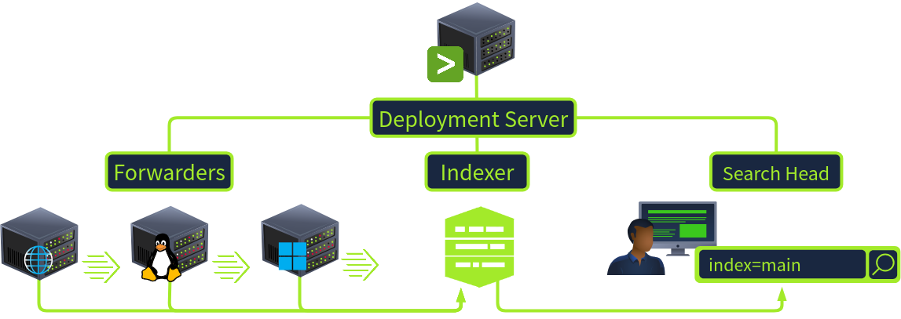

## Linux Splunk Enterprise installation

The source notes identify `splunk_installer.tgz` and `splunkforwarder.tgz` in `~/Downloads/splunk`. The recorded Enterprise installation sequence is:

```bash
cd ~/Downloads/splunk
ls
sudo su
tar xvzf splunk_installer.tgz -C /opt
cd /opt/splunk/bin
./splunk start --accept-license
```

On first startup, Splunk prompts for an administrator username and password. The supplied screenshot shows the web interface becoming available on port `8000`. The notes record `http://10.49.155.197:8000` and `http://coffely:8000`; use the actual address assigned to your own lab machine.

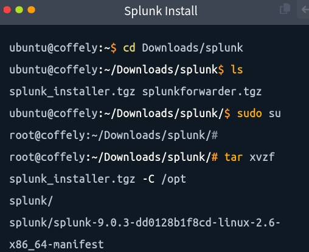

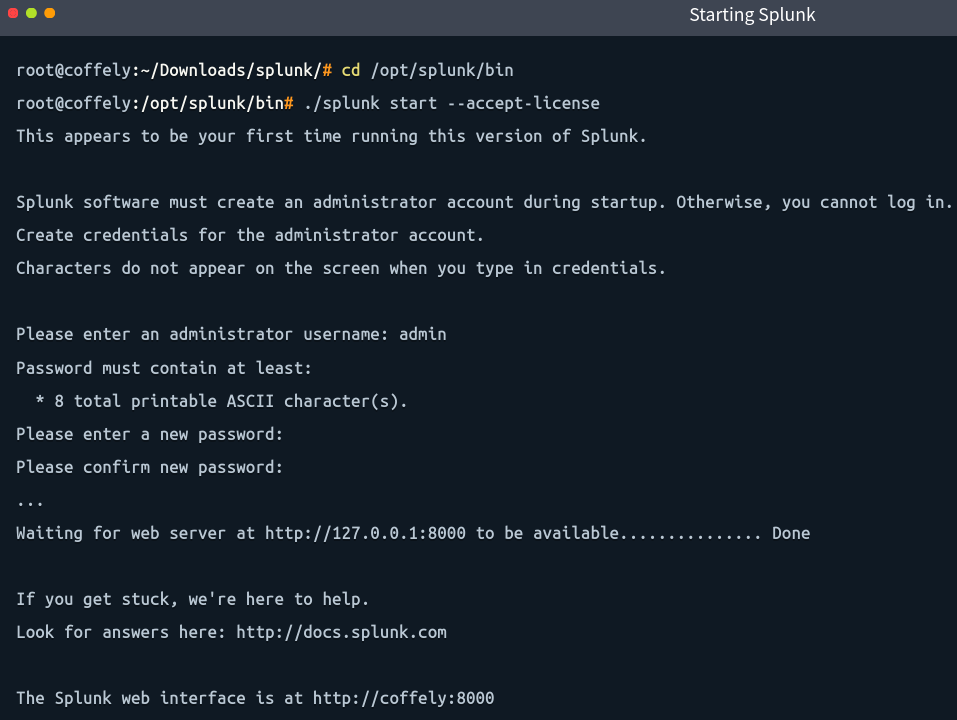

### Basic CLI validation

```bash
cd /opt/splunk/bin
./splunk status
./splunk search coffely
./splunk help
```

The captured status output reports `splunkd` and helper processes running. The CLI search returns events containing the marker string `coffely`. These are observations from the supplied screenshots, not guarantees about a future run.

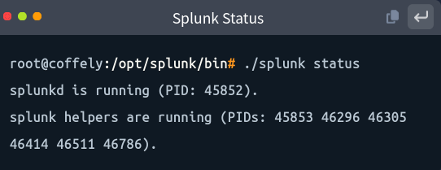

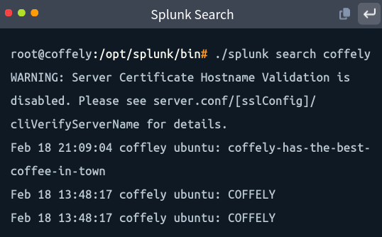

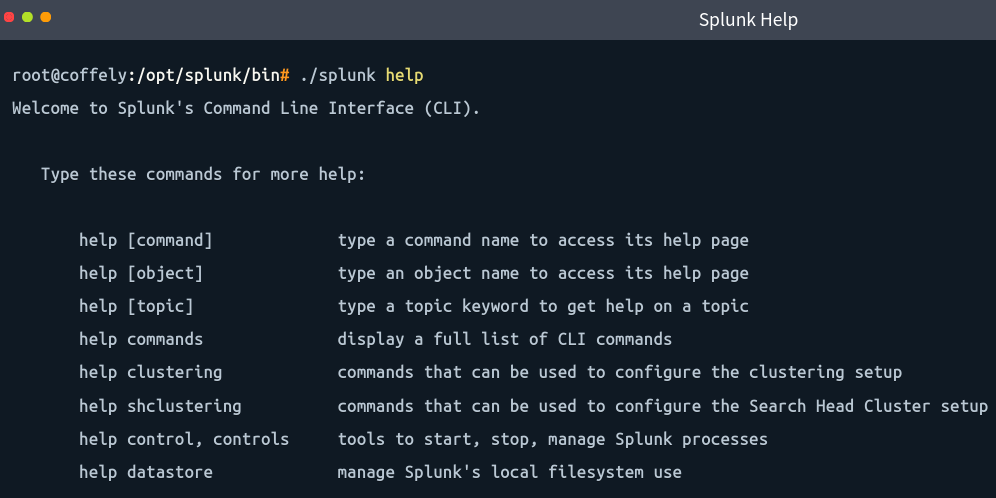

## Linux Universal Forwarder setup

The notes show the Universal Forwarder extracted to `/opt/splunkforwarder`. Its first startup encountered a management-port conflict because port `8089` was already in use by the Enterprise instance. The notes record changing the forwarder's management port to `8090`.

The documented forwarding configuration is:

```bash
cd /opt/splunkforwarder/bin
./splunk add forward-server 10.49.155.197:9997
./splunk add monitor /var/log/syslog -index linux_host
```

The receiving Splunk Enterprise instance must have a receiving port enabled. The walkthrough uses port `9997` and creates an index named `linux_host`.

The notes show this input configuration:

```ini
[monitor:///var/log/syslog]
disabled = false
index = linux_host
```

A test event is generated with `logger` and checked locally:

```bash
logger "coffely-has-the-best-coffee-in-town"
tail -1 /var/log/syslog
```

This confirms the marker was written locally in the captured session. For end-to-end validation, also verify the event is searchable in Splunk, for example with `index=linux_host` and the marker text.

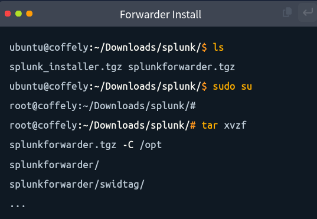

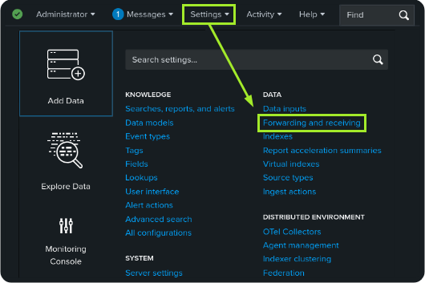

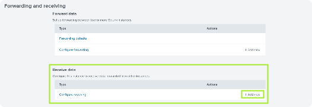

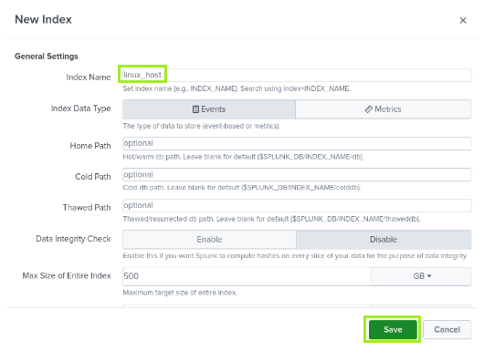

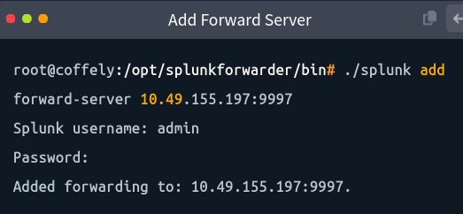

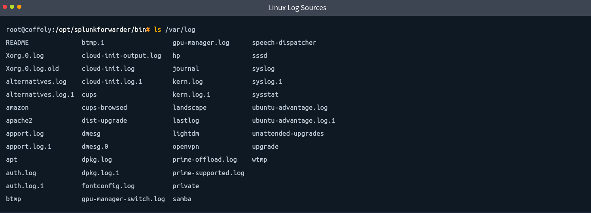

## Windows Splunk Enterprise and Universal Forwarder

The following Windows steps are documented from the supplied Markdown notes. This evidence batch does **not** include Windows configuration screenshots, so treat these as recorded instructions rather than visually verified outcomes.

### Install Splunk Enterprise on Windows

The notes describe running `splunk-instance.exe` from the Windows Downloads folder, accepting the license, and using the default path `C:\Program Files\Splunk`. Create an administrator account during setup. Splunk Web runs on port `8000`, accessed locally at `http://127.0.0.1:8000` or remotely using the lab machine's IP address.

### Enable receiving on the indexer

In Splunk Web, navigate to **Settings → Forwarding and Receiving → Configure Receiving → New Receiving Port**, then configure port `9997`. The source notes use this as the standard receiving port for forwarders.

### Install the Windows Universal Forwarder

The notes describe installing the Universal Forwarder from the downloaded Windows installer, with the default path:

```text
C:\Program Files\SplunkUniversalForwarder
```

Create the forwarder's administrator credentials. The notes say the Deployment Server option can be skipped if centralized forwarder management is not being used. Configure the indexer destination as:

```text
<SPLUNK_SERVER_IP>:9997
```

Use the real IP or resolvable hostname of your lab indexer.

### Collect Windows Event Logs

The source notes describe using **Settings → Forwarder Management** to check for the forwarder, then **Settings → Add Data → Forward** to select the host. Choose **Local Event Logs** and select relevant channels, commonly Security, System, and Application.

Create or select a dedicated index. The notes give `windows_eventlogs` as an example. After submitting the configuration, validate in Search & Reporting:

```spl
index=windows_eventlogs
```

The notes list logons, process creation, service events, application errors, and security audit events as possible event categories. Actual results depend on enabled channels and endpoint activity.

## Windows IIS / Coffely web logs

The notes describe collecting IIS logs from the Windows host running the Coffely test site:

- **Log path:** `C:\inetpub\logs\LogFiles\W3SVC*`
- **Sourcetype:** `iis` or `iis-w3c`, depending on environment/version and available configuration
- **Example index:** `coffely_weblogs`

Select the Windows forwarder host through **Settings → Add Data → Forward**, configure the log directory and sourcetype, then choose the index. Generate test web activity by visiting `http://coffely.thm/` in the intended lab environment and search:

```spl
index=coffely_weblogs
```

The notes describe fields such as `sc-status`, `cs-method`, `cs-uri-stem`, `cs-uri-query`, `time-taken`, `c-ip`, and `user-agent`. Confirm actual field extraction from real events before relying on these fields.

## Validation checklist

- [ ] Splunk Enterprise starts and the web UI is reachable.
- [ ] The indexer is listening on the configured receiving port (`9997` in these notes).
- [ ] The `linux_host` index exists.
- [ ] The Linux Universal Forwarder points to the correct indexer destination.
- [ ] `/var/log/syslog` is monitored and the test marker is searchable in `index=linux_host`.
- [ ] Windows Universal Forwarder is installed and points to the correct indexer destination.
- [ ] Required Windows Event Log channels are enabled and events appear in `index=windows_eventlogs`.
- [ ] IIS logs are monitored with an appropriate sourcetype and events appear in `index=coffely_weblogs`.
- [ ] Capture Windows screenshots or command output before marking that portion evidence-verified.

## Lab-specific caveats

- The supplied notes refer to Splunk 9.0.3 for the Linux package and 9.0.4 for the Windows Universal Forwarder in the described lab. These are historical notes, not a recommendation for production deployment.
- The notes record changing the Universal Forwarder's management port from `8089` to `8090` in a same-host lab. Verify port availability and management access for your own setup.
- A configured forwarding target does not by itself prove successful ingestion. Validate receiving-port status, forwarder connectivity, index selection, and searchable events.
- Avoid exposing credentials or sensitive environment details in public screenshots.

## Source material

- `setting-up-soc-lab-source-notes.md` — supplied source notes preserved for traceability.
- `screenshots/` — selected screenshots supplied with this update.
