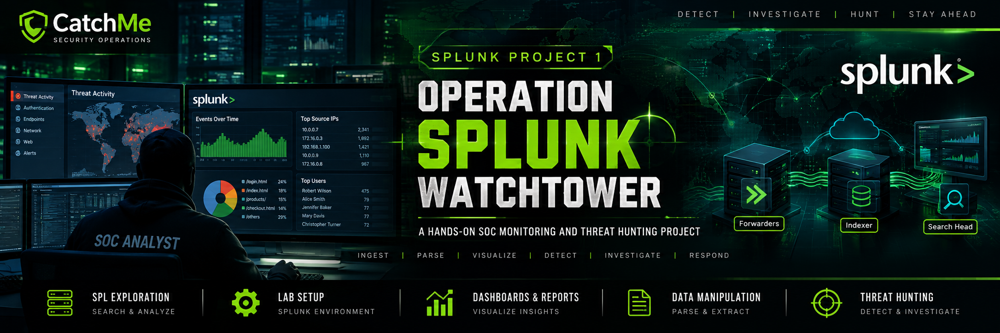

# Operation Splunk Watchtower

**Organization:** CatchMe  
**Project:** Splunk SIEM fundamentals, implementation, and threat-hunting foundations  
**Status:** In progress — evidence collected for Exploring SPL, initial SOC lab setup, and the Dashboards and Reports module. Data manipulation remains pending.

## Objective

Demonstrate practical familiarity with Splunk search, data ingestion, forwarder/indexer architecture, lab configuration, and foundational threat hunting. This repository is built from user-provided notes and screenshots. It is not yet a completed end-to-end SOC investigation.

## Modules

1. **Exploring SPL** — source notes, screenshot evidence, and query library.
2. **Setting Up a SOC Lab** — Linux Enterprise and Universal Forwarder walkthrough, receiving/index setup, and Windows Event Log/IIS configuration notes.
3. **Dashboards and Reports** — source notes, query library, and 16 screenshots organized; live configuration and alert delivery not yet verified.
4. **Data Manipulation** — pending evidence.

## Current package contents

- `01-Exploring-SPL/` — SPL source notes, module report, query library, and 22 screenshots.
- `02-Setting-Up-SOC-Lab/` — module report, original supplied notes, and 18 architecture/Linux setup screenshots. Windows setup is documented from supplied notes; Windows-specific screenshots and end-to-end validation remain pending.
- `03-Dashboards-and-Reports/` — source notes, structured module report, five SPL examples, and 16 screenshots covering reports, alerts, dashboards, and panels.
- `documentation/` — project status, file inventory, runbooks, playbooks, templates, and Mermaid diagrams.
- `evidence/evidence-register.csv` — evidence index for the project.

## Evidence-handling rules

- Treat counts and values shown in screenshots as observations from those captured sessions, not guaranteed current results.
- Suspicious command lines are leads requiring corroboration, not proof that an action succeeded or that an incident occurred.
- Validate SPL and ingestion against actual fields, indexes, sourcetypes, and data before using them operationally.
- Do not include real secrets, credentials, tokens, or sensitive customer data in a public repository.

## Latest update — Setting Up a SOC Lab

- Added the supplied SOC lab notes and a structured module report.
- Added 18 selected screenshots covering architecture, Linux installation/startup, CLI checks, receiving port, index creation, forwarder configuration, and Linux log sources.
- Documented Windows Enterprise installation, Universal Forwarder setup, Windows Event Log collection, and IIS/Coffely web-log collection from the supplied Markdown notes.
- Windows setup is documented but not evidence-verified because Windows-specific screenshots and validation output were not included in this batch.

## Latest update — Dashboards and Reports

- Added the supplied source notes and a structured module report.
- Added a query library for VPN login counts, restricted URI access, hourly 404 counts/thresholds, and response-code distribution.
- Added 16 screenshots covering report creation/scheduling, alert configuration/results, dashboard creation, and panel setup.
- Live report/dashboard/alert deployment and email delivery remain unverified; see the module report.

## Next steps

1. Capture Windows forwarder and Event Log ingestion evidence.
2. Verify Linux and Windows events are searchable in their intended indexes.
3. Continue with dashboards/reports and data manipulation.
4. Validate queries and documentation against the actual lab.
5. Sanitize and review locally before GitHub publication.

## Latest module added — Threat Hunting

`05-Threat-Hunting/` contains a hands-on workbook, SPL query cookbook, field-extraction/event-breaking notes, paste-ready query files, a sample props.conf stanza, and the screenshots supplied for this phase. Queries use `index="main"` as supplied; verify the actual index and fields before interpreting results.
