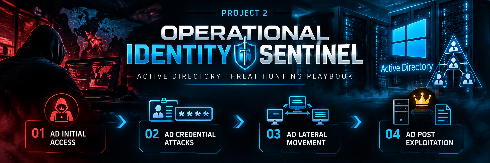

# Project 2: Operational Identity Sentinel



**Focus:** Active Directory security monitoring, attack investigation, and threat hunting  
**Environment:** Authorized lab environment  
**Project type:** Blue-team / SOC investigation portfolio

## Overview

**Operational Identity Sentinel** is a hands-on Active Directory security project focused on investigating suspicious identity activity across the attack lifecycle. It is organized into five modules, progressing from credential-related activity through initial access, lateral movement, post-exploitation, and ongoing Active Directory monitoring.

The goal is to demonstrate how a SOC analyst can use Windows and Active Directory telemetry to investigate suspicious activity, validate findings, document evidence, and recommend defensive actions.

> **Scope note:** This repository documents lab-based analysis and evidence. A suspicious event or command is an investigative lead, not proof by itself that an attack succeeded.

## Project Modules

### 1. AD Credential Attacks

Investigate activity associated with credential exposure, misuse, and suspicious authentication.

- Identify unusual authentication patterns.
- Establish which accounts and systems may be involved.
- Correlate authentication evidence with related process or host activity.
- Record findings, uncertainties, and follow-up checks.

### 2. AD Initial Access

Investigate how an adversary may have obtained an initial foothold in an Active Directory environment.

- Establish the earliest supported suspicious activity.
- Identify affected users, endpoints, and domain systems.
- Correlate authentication, process, and endpoint events where available.
- Avoid assuming an entry method that the logs do not prove.

### 3. AD Lateral Movement

Investigate possible movement between systems after an initial foothold.

- Identify remote logons and suspicious cross-host activity.
- Review remote execution and administrative tooling where telemetry is available.
- Track source account, source host, destination host, and time.
- Distinguish attempted movement from confirmed successful access.

### 4. AD Post-Exploitation

Investigate activity that may occur after an adversary has gained access, including persistence, privilege changes, defense impairment, ransomware preparation, and data destruction.

- Review account creation and group-membership changes.
- Investigate suspicious additions to groups such as **Remote Desktop Users** or **Domain Admins**.
- Examine Volume Shadow Copy discovery or deletion and Windows event-log clearing.
- Investigate suspicious executable creation and remote deployment activity.
- Determine whether ransomware execution and impact are confirmed, attempted, or unverified.

**Example Windows event evidence to correlate:**

| Event ID | Typical meaning |
|---|---|
| 4720 | User account created |
| 4732 | Member added to a security-enabled local group |
| 4728 | Member added to a security-enabled global group |
| 4624 | Successful logon |
| 1102 | Security audit log cleared |
| Sysmon 11 | File created, when Sysmon telemetry is configured |

Event meaning depends on the event source, available fields, and environment configuration. Validate event details before drawing conclusions.

### 5. Monitoring Active Directory

Build repeatable monitoring and detection opportunities for identity and domain activity.

- Track sensitive group-membership changes and account creation.
- Review unusual authentication and remote-access patterns.
- Monitor suspicious administrative tooling and defense-evasion behavior.
- Create repeatable searches, alerts, and dashboards where the lab supports them.
- Document tuning considerations, false positives, and validation status.

## Investigation Workflow

1. **Define the question** — state the behavior or hypothesis being investigated.
2. **Search the relevant data** — confirm the index, sourcetype, host, time range, and field names.
3. **Review raw events** — use tables for triage, then inspect original events before reaching a conclusion.
4. **Correlate evidence** — connect timestamps, accounts, hosts, process identifiers, and related events.
5. **Assess confidence** — classify the activity as confirmed, likely, suspicious, attempted, or unverified based on evidence.
6. **Document the result** — record the query, observed output, interpretation, limitations, and next steps.
7. **Recommend response** — provide proportionate containment, investigation, and recovery recommendations.

## Evidence and Reporting Standards

| Item | What to record |
|---|---|
| Objective | The question the search is intended to answer |
| Data source | Index, sourcetype, host, and relevant event source |
| SPL query | The exact query used, formatted as a code block |
| Observations | What the events and results actually show |
| Interpretation | Why the activity is suspicious or potentially benign |
| Correlation | Related accounts, hosts, timestamps, and process details |
| Confidence | Confirmed, likely, suspicious, attempted, or unverified |
| Limitations | Missing telemetry, field-extraction issues, or coverage gaps |
| Next steps | Additional searches, validation, or response actions |

Use sanitized screenshots and avoid publishing real credentials, tokens, sensitive personal information, or confidential organizational data.

## Tools and Technologies

The exact tools depend on the evidence available in each module. The project may use:

- Splunk Search Processing Language (SPL) for searching and correlating events.
- Windows Security event logs and Active Directory audit events.
- Sysmon process and file telemetry, where configured.
- MITRE ATT&CK techniques to categorize observed behaviors.
- Markdown reports and Mermaid diagrams to document timelines and investigation logic.

Do not assume a data source or field is present until it has been verified in the lab.

## Repository Structure

Suggested structure:

```text
Project-2-Operational-Identity-Sentinel/
├── README.md
├── 01-AD-Credential-Attacks/
├── 02-AD-Initial-Access/
├── 03-AD-Lateral-Movement/
├── 04-AD-Post-Exploitation/
└── 05-Monitoring-Active-Directory/
```

Keep each module's SPL queries, screenshots, report, and diagrams together. Adjust these example folder names to match the actual repository.

## Project Status

Each module should distinguish among:

- **Documented** — notes or procedures have been written.
- **Tested** — the query or procedure has been run in the lab.
- **Validated** — results have been checked against underlying events and expected behavior.

Do not label an alert, dashboard, or attack outcome as validated unless it has been tested and the supporting evidence reviewed.

## Disclaimer

This project is for authorized lab learning, defensive security analysis, and portfolio demonstration. Perform testing only in environments where you have permission. Findings and detection logic should be validated against the specific telemetry and configuration of the target environment.
