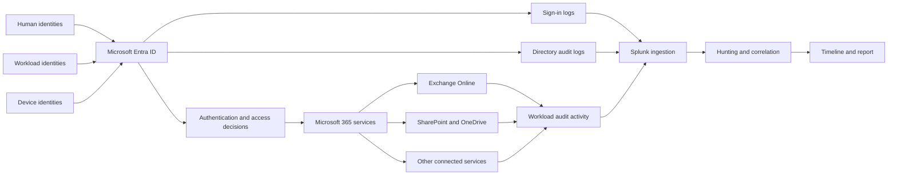

# Architecture and Data Flow

## Sources seen in the evidence
| Sourcetype | Purpose | Important fields observed |
|---|---|---|
| `azure:aad:signin` | Authentication attempts | `userPrincipalName`, `ipAddress`, `appDisplayName`, `status.errorCode`, `clientAppUsed`, `conditionalAccessStatus` |
| `azure:aad:audit` | Identity/directory changes | `activityDisplayName`, `initiatedBy.user.userPrincipalName`, `initiatedBy.app.displayName`, `targetResources{}.userPrincipalName`, `result` |
| `o365:management:activity` | Workload activity | `Operation`, `UserId`, `ClientIP` / `ClientIPAddress`, `Workload`, `ObjectId` |

Field names vary by connector and extraction settings. Validate raw events, timestamp handling, normalization, retention, and collection coverage before building production detections.
