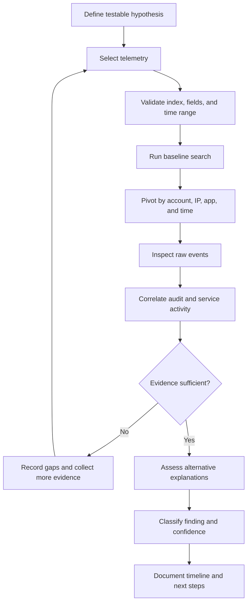

# Investigation Methodology

## Evidence standard
- **Observed fact:** directly supported by a log or search result.
- **Interpretation:** what the observation may mean.
- **Hypothesis:** a proposition requiring further testing.
- **Confirmed conclusion:** supported by sufficient evidence and alternative-explanation review.
- **Limitation:** missing data, uncertain attribution, or schema/retention assumptions.

## Classification
| Classification | Meaning |
|---|---|
| Observed | Event is visible; intent is not established |
| Suspicious | Pattern warrants investigation; benign explanations remain |
| Confirmed malicious | Evidence supports malicious intent/activity |
| Benign | Context supports legitimate activity |
| Inconclusive | Evidence is unavailable or conflicting |

A source IP is not a person. A successful password reset may be legitimate recovery or an unauthorized action. Confirm user intent through an independent channel when appropriate.
