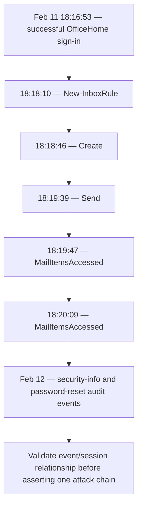

# Phase 1 Threat-Hunting Report — M365 Monitoring Basics

**Case:** OCM-P1-001  
**Status:** Open — further validation required  
**Provisional priority:** Medium pending scope and business context  
**Confidence:** High that the displayed search results contain the listed events; low-to-moderate that they establish malicious activity.

## Executive summary
The reviewed results show concentrated failed sign-in activity for one account from one source IP, followed by successful sign-ins from the same source. Exchange workload events include inbox-rule creation, a create operation, sending, and mailbox-item access within about four minutes of the earliest successful sign-in displayed. Separate audit results show security-information registration and password-reset-related events on the following day.

This sequence warrants a focused identity-compromise and mailbox-abuse investigation. The evidence does **not** yet prove compromise, malicious rule behavior, or data exfiltration.

## Scope and facts
- Broad sign-in search: 56 events.
- Failed-sign-in aggregation: 26 events for one account/app/source; visible codes `50126` and `50140`.
- Successful source-IP pivot: 30 events, including `My Profile`, `My Signins`, `OfficeHome`, and `One Outlook Web`.
- Earliest successful event shown: `2026-02-11 18:16:53`, `OfficeHome`.
- Target-focused audit query: 13 events. Actor-focused audit query: 8 events.
- Exchange activity: 5 events from `18:18:10` to `18:20:09` on Feb 11.
- Visible operations: `New-InboxRule`, `Create`, `Send`, and two `MailItemsAccessed`.

## Hypotheses
### H1 — Credential attack followed by successful access
**Status:** Plausible, not confirmed. Review ordered raw events, full error details, device/client context, authentication details, risk signals, and other accounts associated with the source.

### H2 — Inbox-rule operation may represent mailbox abuse
**Status:** Suspicious enough to investigate, not confirmed malicious. Inspect the rule's conditions/actions, forwarding or redirect destination, deletion/move behavior, actor/session context, and expected business use.

### H3 — Next-day recovery/security-info events may be related
**Status:** Link unproven. Review audit modified properties, correlation/session IDs, and independently confirm whether the user initiated the actions.

### H4 — A second source IP appears in mailbox access
**Status:** Contextual pivot only. Validate source ownership and client/device/session information; IP alone cannot identify a person.

## Timeline

## ATT&CK considerations (hypotheses only)
- **T1110 — Brute Force:** only if event order and context support password guessing/spraying.
- **T1078 — Valid Accounts:** only if unauthorized use is established.
- **T1098 — Account Manipulation:** if audit details establish unauthorized authentication-method or account changes.
- **T1114 — Email Collection:** if unauthorized mailbox collection/access is established.

Do not assign techniques solely because a related event name appears.

## Alternative explanations
- User typo, expired password, or normal authentication retries.
- Legitimate self-service recovery or security-info registration.
- Expected inbox rule created by the user/admin.
- Service, VPN, proxy, or client infrastructure explaining the second source.
- Timezone mismatch or delayed ingestion.

## Recommended next steps
1. Export raw sign-in events with exact time, authentication details, client, device, Conditional Access, and risk context.
2. Expand `New-InboxRule` and inspect every rule condition/action and destination.
3. Review raw `Create`, `Send`, and `MailItemsAccessed` event details and session identifiers.
4. Investigate both source IPs using approved enrichment and tenant context.
5. Review audit modified properties and independently validate the user's reset/security-info actions.
6. Search for other accounts and service events associated with the same source, session, or correlation identifiers.
7. If unauthorized activity is corroborated, follow incident-response procedures: revoke sessions, reset credentials, review authentication methods, remove unauthorized rules, scope mailbox/file access, and preserve evidence.

## Screenshot evidence register
The complete screenshot set is included in [`evidence/screenshots/`](../evidence/screenshots/README.md). Key references:

| Evidence | Screenshot | Relevance |
|---|---|---|
| SS-01 | `01-entra-id-identity-architecture.png` | Identity and service architecture context |
| SS-02 | `02-conditional-access-login-signals.png` | Authentication signals and access decisions |
| SS-03 | `03-signin-event-overview.png` | 56-event broad sign-in search |
| SS-04 | `04-failed-signin-aggregation.png` | 26 failed sign-ins; visible codes 50126 and 50140 |
| SS-05 | `05-successful-signin-source-pivot.png` | 30 successful sign-in events in the source-IP pivot |
| SS-06 | `06-first-successful-signin-timeline.png` | Successful OfficeHome sign-in timestamp displayed |
| SS-07 | `07-audit-events-targeting-user.png` | 13 target-focused audit events |
| SS-08 | `08-audit-events-initiated-by-user.png` | 8 actor-focused audit events |
| SS-09 | `09-exchange-workload-activity.png` | Five Exchange operations in the observed sequence |
| SS-10 | `10-mail-items-accessed-event-detail.png` | Focused MailItemsAccessed pivot |
| SS-11 | `11-m365-management-activity-overview.png` | Broader Microsoft 365 management activity view |

The screenshots are direct supporting evidence for the observations above, not independent proof of malicious intent. Some screenshots show identifiers and host details; review them before public release.

## Conclusion
The evidence demonstrates a useful cross-source hunting path but does not support a definitive compromise verdict. The next decisive evidence is the full inbox-rule action and actor/session context, raw sign-in detail, and validation of the account recovery events.
