# Operation Cloud Mailwatch — Entra ID Identity-Threat Monitoring

A security monitoring, threat-hunting, and incident response portfolio project focused on detecting and investigating identity-based attacks against **Microsoft Entra ID** (`finegalo.thm`) using **Splunk**.

---

## Project Overview

| Attribute | Details |
| :--- | :--- |
| **Project Name** | Operation Cloud Mailwatch |
| **Target Environment** | Microsoft Entra ID (Azure AD) — Tenant `finegalo.thm` |
| **SIEM Platform** | Splunk |
| **Project Focus** | Identity-Threat Detection, Threat Hunting & Incident Response |
| **Current Stage** | Phase 2 — Complete SPL Query Pack & Splunk Evidence Integration |

---

## End-to-End Attack Kill Chain & Detection Architecture

The diagram below models the full identity intrusion lifecycle observed across the investigated Entra ID telemetry—from external password-based attacks and MFA fatigue through account takeover, privilege escalation, persistence, and OAuth application exposure—mapped to the Splunk log sources and detections in this repository.

```mermaid
flowchart LR
    %% ───────── Attack kill chain ─────────
    subgraph ATK["Attacker Kill Chain"]
        direction LR
        A1["<b>Module 01</b><br/>Password Attacks<br/>Spray 94.20.222.248 (AZ)<br/>Brute force 38.165.231.218 (MX)"]
        A2["<b>Module 02</b><br/>Conditional Access Evasion<br/>Blocked by 'Block Suspicious Countries'"]
        A3["<b>Module 03</b><br/>MFA Fatigue<br/>149.102.234.27 (BR)<br/>10 denials, then success"]
        A4["<b>Module 04</b><br/>Privilege Escalation<br/>Rogue user + Global Administrator"]
        A5["<b>Module 04</b><br/>Persistence<br/>Attacker MFA registration"]
        A6["<b>Module 05</b><br/>OAuth Abuse<br/>Consent to app, Mail.Read.All"]
        A1 --> A2 --> A3 --> A4 --> A5 --> A6
    end

    %% ───────── Telemetry ─────────
    subgraph LOG["Entra ID Telemetry"]
        direction TB
        L1[("azure:aad:signin<br/>errorCode 50126 / 500121 / 0")]
        L2[("azure:aad:audit<br/>Add user, Add member to role,<br/>Security info registration,<br/>Consent to application")]
        L3[("Identity Protection<br/>riskLevel / riskState")]
    end

    %% ───────── Detection ─────────
    subgraph DET["Splunk Detections"]
        direction TB
        D1["01 Password spray and<br/>throttled brute force + compromise pivot"]
        D2["02 Risky user and<br/>Conditional Access failures"]
        D3["03 MFA fatigue and<br/>baseline country deviation"]
        D4["04 Rogue user, Global Admin<br/>assignment, MFA registration"]
        D5["05 App consent and<br/>high-risk Graph permissions"]
    end

    %% ───────── Response ─────────
    subgraph IR["SOC Response"]
        direction TB
        R1["Triage and validate"]
        R2["Contain: revoke sessions,<br/>reset credentials, block IP"]
        R3["Eradicate: remove rogue<br/>admin and MFA methods,<br/>revoke app consent"]
        R1 --> R2 --> R3
    end

    %% Attack -> telemetry
    A1 -.-> L1
    A2 -.-> L1
    A2 -.-> L3
    A3 -.-> L1
    A4 -.-> L2
    A5 -.-> L2
    A6 -.-> L2

    %% Telemetry -> detections
    L1 --> D1
    L1 --> D2
    L3 --> D2
    L1 --> D3
    L2 --> D4
    L2 --> D5

    %% Detections -> response
    D1 --> R1
    D2 --> R1
    D3 --> R1
    D4 --> R1
    D5 --> R1

    %% Styling
    classDef atk fill:#fde2e2,stroke:#c0392b,color:#000;
    classDef log fill:#e8f0fe,stroke:#2f5fd0,color:#000;
    classDef det fill:#e6f7ea,stroke:#2e8b57,color:#000;
    classDef ir fill:#fff4d6,stroke:#d4a017,color:#000;
    class A1,A2,A3,A4,A5,A6 atk;
    class L1,L2,L3 log;
    class D1,D2,D3,D4,D5 det;
    class R1,R2,R3 ir;
```



---

## Threat Coverage & Investigation Findings

| Module | Threat Domain | Key Telemetry & Observed Findings | Validation Status |
| :--- | :--- | :--- | :--- |
| **01** | **Password-Based Attacks** | • **Password Spray:** `94.20.222.248` (`AZ`) targeted **7 unique accounts** with **14 failed attempts** (`status.errorCode=50126`, 2 failures per user).<br>• **Throttling Brute Force & Compromise:** `38.165.231.218` (`MX`) targeted `amanda.costa@finegalo.thm` with **4 failed attempts** followed by **3 successful logins** (`status.errorCode=0`). | **Validated (4 Splunk Screenshots)** |
| **02** | **Conditional Access & Identity Protection** | • **Risky User:** `allan.senna@finegalo.thm` flagged in Identity Protection (`riskLevel=high`, `riskState=atRisk`, event time `2026-03-03 19:46:39`, `anonymizedIPAddress` risk context).<br>• **Conditional Access Enforcement:** Policy **`Block Suspicious Countries`** blocked **6 sign-in attempts** (`conditionalAccessStatus=failure`) to `OfficeHome` (`5` from `94.20.222.251` between `13:30:26`–`13:31:16` and `1` from `94.20.222.248` at `12:51:53`). | **Validated (2 Splunk Screenshots)** |
| **03** | **MFA Bypass Techniques** | • **MFA Fatigue Attack:** `igor.bicalho@finegalo.thm` targeted from `149.102.234.27` (`BR`) with **10 consecutive MFA prompt denials** (`status.errorCode=500121`) between `12:30:06` and `13:24:13`.<br>• **Geographic Baseline & Compromise:** User baseline sign-ins originated from `96.0.24.134` in **Denmark (`DK`)**; attacker achieved a successful login (`status.errorCode=0`) from `149.102.234.27` (**Brazil (`BR`)**) at `2026-03-04 13:26:22`. | **Validated (3 Splunk Screenshots)** |
| **04** | **Privilege Escalation & Persistence** | • **Account Creation (`2026-03-04 13:31:48.764`):** Compromised actor `igor.bicalho@finegalo.thm` executed `Add user` to create `rafael.maciel@finegalo.thm`.<br>• **Role Elevation (`2026-03-04 13:31:49.154`):** `igor.bicalho@finegalo.thm` executed `Add member to role` assigning **`Global Administrator`** (`62e90394-69f5-4237-9190-012177145e10` / `TenantAdmins`) to `rafael.maciel@finegalo.thm`.<br>• **MFA Persistence (`2026-03-04 13:36`):** `User started security info registration` (`operationType="Add"`) recorded. | **Validated (2 Splunk Screenshots)** |
| **05** | **OAuth Application Abuse** | • **Audit Monitoring:** Tracking `activityDisplayName="Consent to application"` in `azure:aad:audit`.<br>• **High-Risk Scope Focus:** Detecting tenant-wide mailbox read exposure via **`Mail.Read.All`**. | Detection Logic Documented |

---

## Repository Structure

```text
operation-cloud-mailwatch-entra-id-monitoring/
│
├── README.md                                              # Project landing page, kill-chain diagram & findings summary
├── BUILD-STATUS.md                                        # Phased build tracker and validation matrix
│
├── docs/
│   ├── 01-entra-id-monitoring-source.md                   # Preserved source investigation notes (unmodified)
│   └── architecture-and-workflows.md                      # Mermaid diagrams: kill chain, detection pipeline & SOC workflows
│
├── detections/
│   └── splunk/
│       ├── README.md                                      # SPL detection index & validation policy
│       ├── all-detections.spl                             # Consolidated, runnable SPL query pack (Modules 01–05)
│       ├── 01-password-based-attacks.md                   # Password spray, throttling brute force & compromise pivot SPL
│       ├── 02-conditional-access-identity-protection.md   # Risky user & Conditional Access failure SPL
│       ├── 03-mfa-bypass-techniques.md                    # MFA fatigue (500121) & baseline country deviation SPL
│       ├── 04-privilege-escalation-persistence.md         # Rogue user, Global Admin assignment & MFA registration SPL
│       └── 05-oauth-application-abuse.md                  # Application consent & high-risk Graph permission SPL
│
├── investigation-playbooks/
│   └── README.md                                          # Step-by-step SOC analyst triage & containment playbooks
│
├── evidence/
│   └── screenshots/
│       ├── README.md                                      # Complete screenshot inventory and query mapping (11 captures)
│       ├── 01-password-attacks-failed-signins-timeline.png
│       ├── 01-password-spray-ip-aggregation.png
│       ├── 01-throttling-bruteforce-per-user-ip.png
│       ├── 01-throttling-bruteforce-compromise-pivot.png
│       ├── 02-risky-user-identity-protection.png
│       ├── 02-conditional-access-block-suspicious-countries.png
│       ├── 03-mfa-fatigue-500121-summary.png
│       ├── 03-mfa-baseline-country-signins.png
│       ├── 03-mfa-fatigue-dk-to-br-timeline.png
│       ├── 04-rogue-user-creation-audit.png
│       └── 04-privileged-role-assignment-audit.png
│
└── references/
    └── README.md                                          # Entra ID schemas, error codes, CIM & MITRE ATT&CK mapping
```
