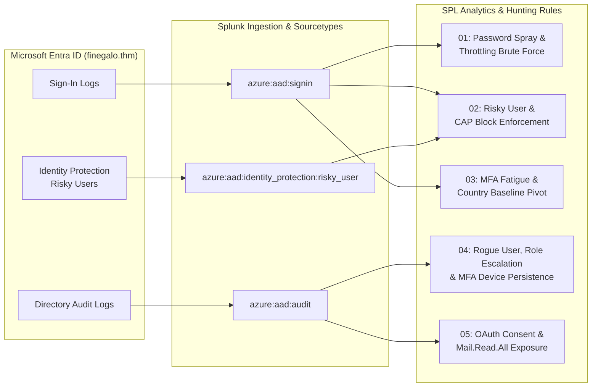
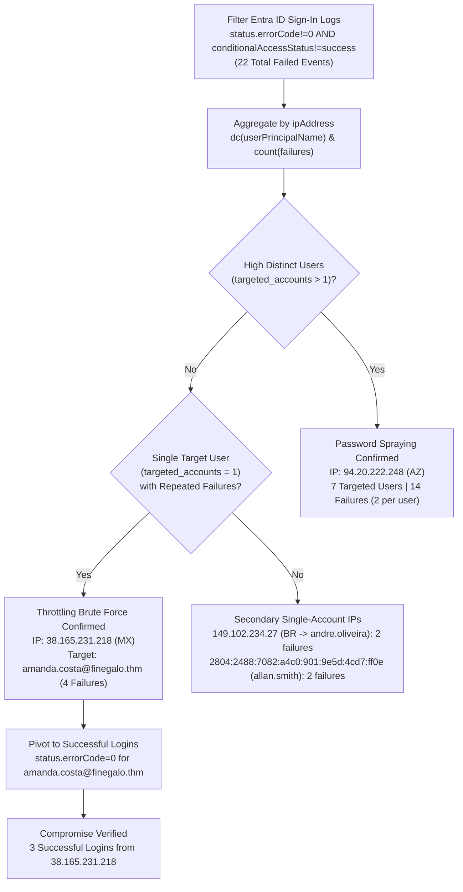
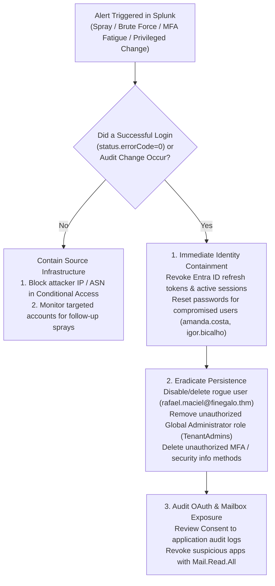

# Architecture, Detection Logic & Investigation Workflows (Mermaid Diagrams)

This document contains GitHub-renderable Mermaid diagrams modeling the Entra ID telemetry pipeline, observed attack timelines, detection decision trees, and SOC triage workflows for **Operation Cloud Mailwatch**.

---

## 1. Entra ID Telemetry Ingestion & Splunk Detection Architecture



---

## 2. Module 01 — Password Attack Classification & Compromise Pivot Flowchart

Based on `index="task-2"` (`22` failed sign-in events with `status.errorCode=50126` on `OfficeHome`):



---

## 3. Observed Incident Timeline (2026-02-25 to 2026-03-04)

```mermaid
timeline
    title Entra ID Attack & Compromise Progression (finegalo.thm)
    2026-02-25 12:33 - 12:34 : Password Spraying (94.20.222.248 / AZ)
                             : 14 failed logins (Error 50126) across 7 accounts on OfficeHome
    2026-02-25 12:35 : Secondary Failed Attempts (149.102.234.27 / BR)
                     : 2 failed logins against andre.oliveira@finegalo.thm
    2026-02-25 12:39 - 13:00 : Throttling Brute Force (38.165.231.218 / MX)
                             : 4 paced failed attempts against amanda.costa@finegalo.thm -> 3 successful logins
    2026-03-03 12:51 - 13:31 : Conditional Access Enforcement
                             : Block Suspicious Countries blocked 6 OfficeHome attempts for Allan Senna (94.20.222.248 & 94.20.222.251)
    2026-03-03 19:46 : Identity Protection Risk Flag
                     : allan.senna@finegalo.thm marked riskLevel=high / riskState=atRisk
    2026-03-04 12:30 - 13:26 : MFA Fatigue & Compromise (igor.bicalho@finegalo.thm)
                             : 10 MFA denials (Error 500121) from 149.102.234.27 (BR) -> successful login at 13:26:22 (baseline: 96.0.24.134 / DK)
    2026-03-04 13:31 - 13:36 : Privilege Escalation & Persistence
                             : igor.bicalho@finegalo.thm created rafael.maciel@finegalo.thm (13:31:48), assigned Global Administrator (13:31:49), and added MFA device (13:36)
```

---

## 4. SOC Analyst Incident Response & Containment Workflow


