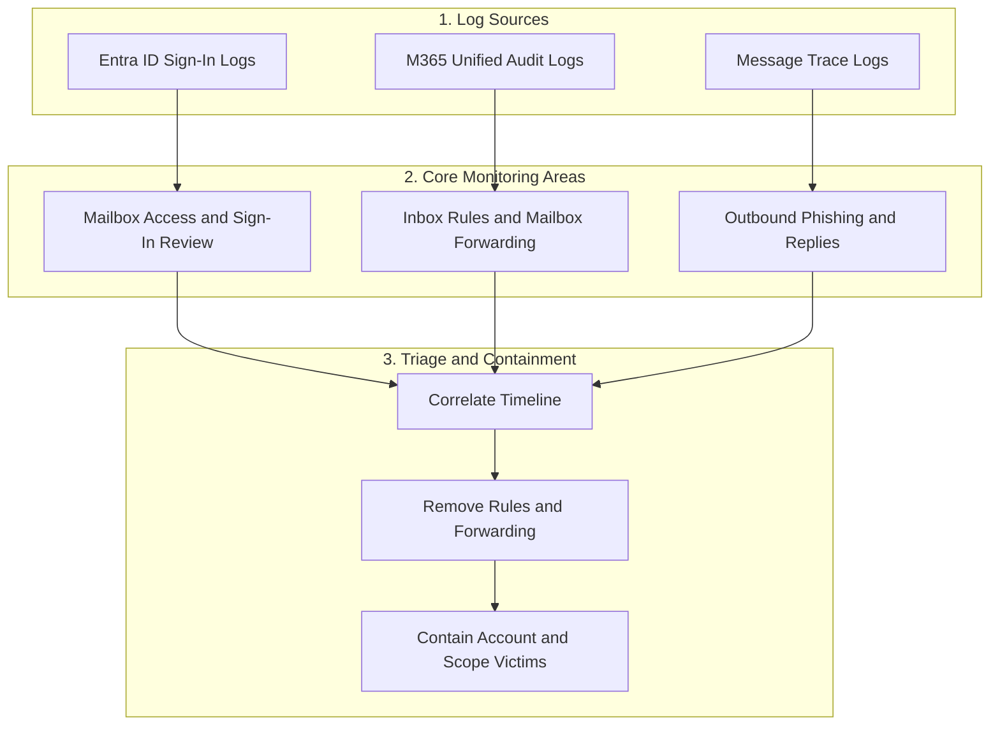

# Exchange Online Monitoring & Threat Hunting Project (v4)

## Overview
Exchange Online monitoring and incident investigation package covering **Initial Access**, **Inbox Rule & Mailbox Forwarding Abuse**, and **Compromised Account Phishing** in Splunk (`One Outlook Web` sign-ins, `Workload=Exchange` audit logs, and `o365:reporting:messagetrace`).

## Architecture & Investigation Flow

## Included Files
* `charts/exchange_activity_summary.png` — Visual chart of query event counts and Robert Green compromise sequence
* `evidence/screenshots/` — Actual captured Splunk screenshots (`01` through `07`)
* `evidence/investigation_findings.md` — Embedded screenshot references, case findings, and timeline notes
* `detections/exchange_monitoring_queries.spl` — Splunk SPL queries
* `playbooks/exchange_compromise_triage.md` — Incident response playbook
* `dashboards/exchange_monitoring_dashboard.json` — Dashboard panel queries
