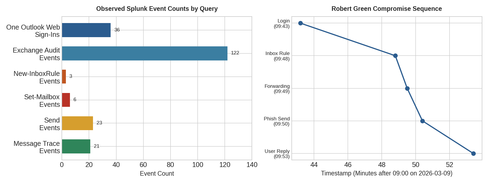
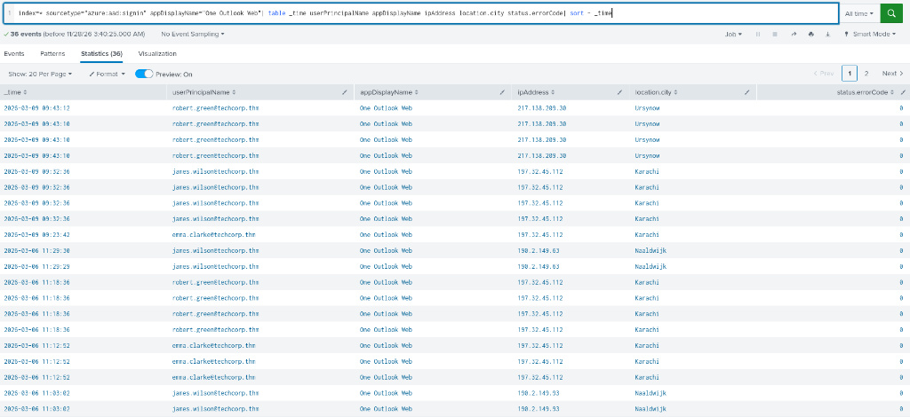
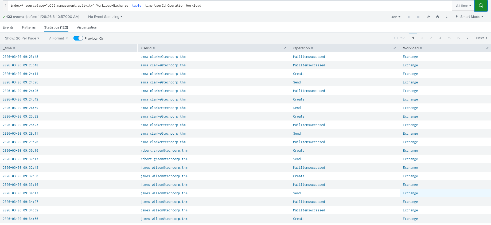
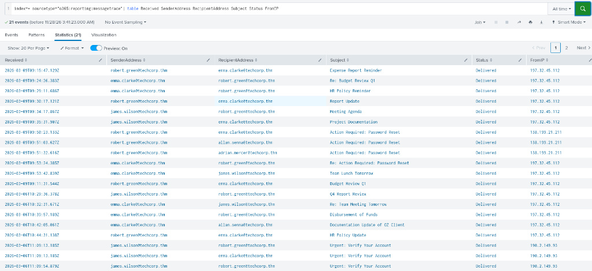
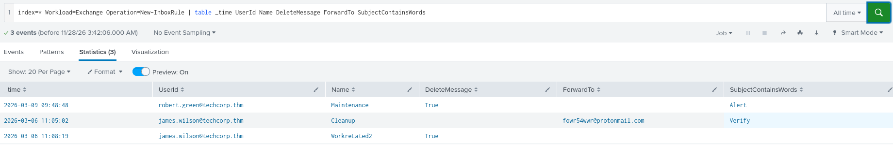
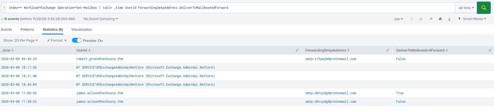
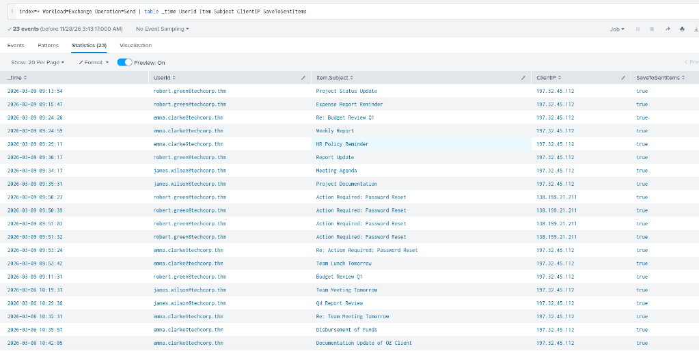
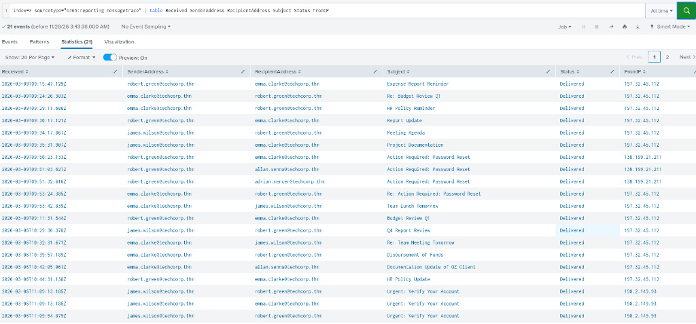

# Investigation Summary & Evidence Index (v4)

## Summary Chart

## Captured Splunk Screenshots
* `01_signin_one_outlook_web.png` — One Outlook Web sign-ins (`36` events)
  
* `02_exchange_audit_operations.png` — Exchange workload audit events (`122` events)
  
* `03_message_trace_overview.png` — Message trace overview (`21` events)
  
* `04_new_inbox_rule_forwarding.png` — Inbox rule creation (`Cleanup`, `Maintenance`, `WorkreLated2`)
  
* `05_set_mailbox_forwarding.png` — Mailbox-level forwarding (`d4ruy6g@protonmail.com`, `x7tpq2m@protonmail.com`)
  
* `06_send_operation_phishing.png` — Outbound `Send` events (`23` events)
  
* `07_message_trace_phishing_detail.png` — Message trace phishing campaigns and recipient reply
  

## Key Findings
* **James Wilson (`james.wilson@techcorp.thm`):** Rule `Cleanup` (subject word `Verify`), forwarding `d4ruy6g@protonmail.com`, phishing subject `Urgent: Verify Your Account` from `190.2.149.93`.
* **Robert Green (`robert.green@techcorp.thm`):** Login from `Ursynow` (`217.138.209.30` at `09:43:12`–`09:43:18`), rule `Maintenance` (`Alert`, `DeleteMessage=True` at `09:48:48`), forwarding `x7tpq2m@protonmail.com` (`DeliverToMailboxAndForward=False` at `09:49:29`), phishing subject `Action Required: Password Reset` from `138.199.21.211`, reply from `emma.clarke@techcorp.thm` at `09:53:24`.
