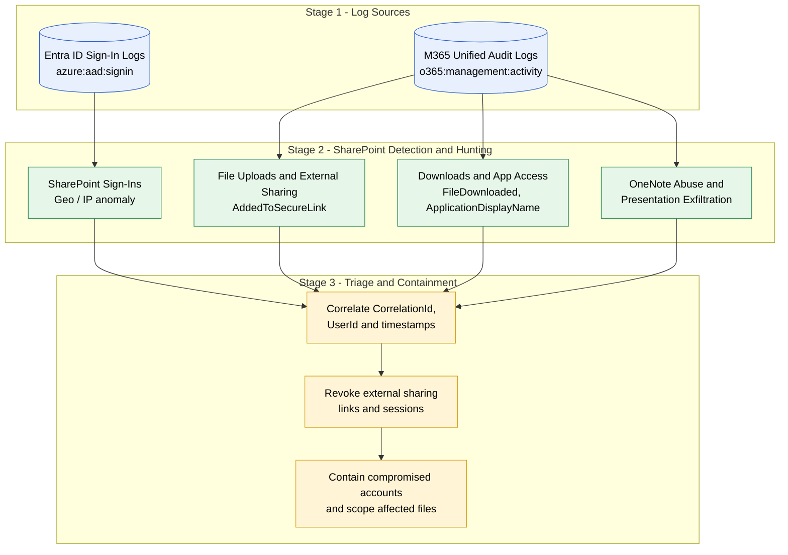

# SharePoint Online Monitoring & Threat Hunting Project

## Overview
This project covers **SharePoint Online Monitoring**, **External Sharing & Data Exfiltration Detection**, and **OneNote Phishing / Incident Investigation** in Splunk using Entra ID sign-in logs (`azure:aad:signin`) and Microsoft 365 Unified Audit logs (`o365:management:activity`).

## Architecture & Investigation Flow

## Key Investigation Findings
* **Emily Turner (`emily.turner@tryhackme.thm`):** SharePoint sign-in event ID `22192ff2-272a-458c-8fac-7155db417700`; uploaded `Instructions.pdf`; shared with external guest `ahmad.khan@opendoor.thm`.
* **Data Exfiltration & SharePoint Abuse:** `FileDownloaded` tracks downloads; `ApplicationDisplayName` identifies the client app; `OneNote` files are commonly abused for phishing; `AddedToSecureLink` tracks external link sharing.
* **Emma Lawson & Michael Scenario:** Michael (`michael.els@tryhackme.thm`) opened the shared OneNote file at `2026-02-03T12:49:44`; Emma shared `Important Updates Regarding Pricing [B2B and B2E]` with `LI.WANG@TRYHATME.THM`, `SUSAN.MOORE@DECEPTITECH.THM`, and `WILLIAM.BAKER@PROBABLYFINE.THM`; sharing link `CorrelationId` is `7d5bf3a1-e053-0000-a921-8f2194ce0b64`; exfiltrated presentation is `THM PoC B2E.pptx` (`WebPowerPoint`); malicious sign-in city is `Amsterdam` (`212.8.250.220`).

## Repository Structure
* `README.md` — Project overview, Mermaid diagram, and investigation findings
* `charts/sharepoint_monitoring_summary.png` — Visual chart of observed event counts and artifacts
* `detections/sharepoint_monitoring_queries.spl` — Splunk SPL queries for SharePoint sign-ins, uploads, sharing, downloads, and OneNote/PowerPoint activity
* `playbooks/sharepoint_compromise_triage.md` — Triage and containment playbook
* `dashboards/sharepoint_monitoring_dashboard.json` — Dashboard panel definitions
* `evidence/investigation_findings.md` — Detailed case findings and screenshot index
