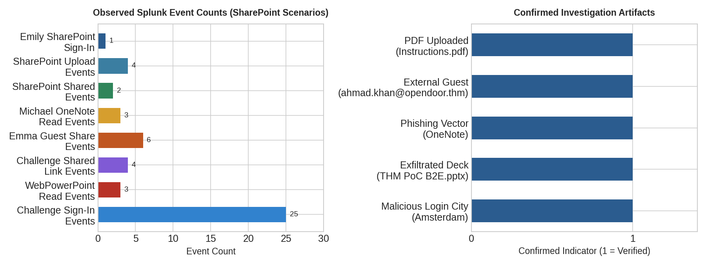

# SharePoint Online Investigation Findings

## Summary Chart

## Practice Scenario (Emily Turner)
* **SharePoint Sign-In Event ID:** `22192ff2-272a-458c-8fac-7155db417700`
* **Uploaded PDF:** `Instructions.pdf`
* **External Target User:** `ahmad.khan@opendoor.thm` (`urn:spo:guest#ahmad.khan@opendoor.thm`)

## Detection Concepts
* **Download Event:** `FileDownloaded`
* **Application Field:** `ApplicationDisplayName`
* **Common Phishing File Type:** `OneNote`
* **External Sharing Event:** `AddedToSecureLink`

## Real-World Scenario (Emma Lawson & Michael)
* **Michael Opened OneNote File:** `2026-02-03T12:49:44` (`michael.els@tryhackme.thm`)
* **Three External Emails Shared By Emma:** `LI.WANG@TRYHATME.THM`, `SUSAN.MOORE@DECEPTITECH.THM`, `WILLIAM.BAKER@PROBABLYFINE.THM` (`Important Updates Regarding Pricing [B2B and B2E]`)
* **CorrelationId Proving Sharing Link Opened:** `7d5bf3a1-e053-0000-a921-8f2194ce0b64`
* **Exfiltrated PowerPoint Presentation:** `THM PoC B2E.pptx` (`https://tryhackme.sharepoint.com/sites/marketing/Shared Documents/Drafts/THM PoC B2E.pptx`, via `WebPowerPoint`)
* **Malicious Sign-In City:** `Amsterdam` (`212.8.250.220`, `OfficeHome`)
