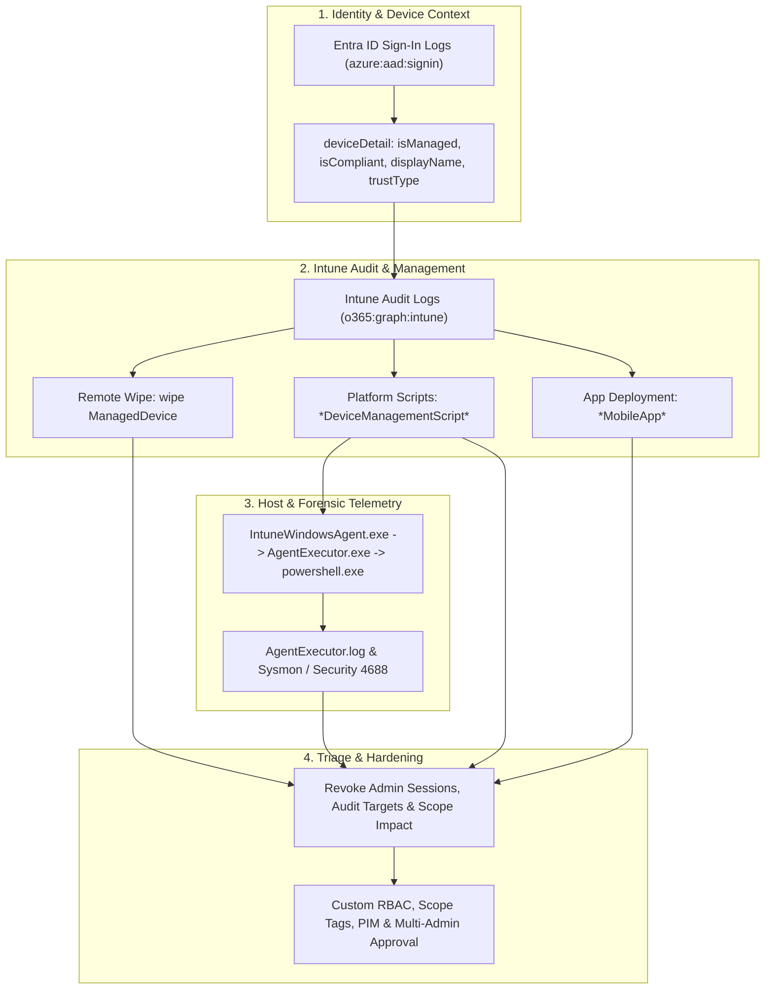

# Microsoft Intune Monitoring & Threat Hunting Project

## Overview
This project covers **Microsoft Intune SOC Monitoring**, **Entra ID + Intune Correlation**, **Remote Wipe & Platform Script / App Abuse Detection**, **Windows Endpoint Artifacts (`AgentExecutor.exe` & `AgentExecutor.log`)**, and **Intune Hardening (RBAC, Scope Tags, Multi-Admin Approval)** in Splunk.

## Architecture & Investigation Flow

## Confirmed Investigation Findings
* **Remote Wipe Case (`LPT-03812`):** Wiped device ID `d66b71f3-a644-4392-89b2-d97ba5612356`, hostname `LPT-03812`, performed by `steven.mills@tryhackme.thm` from IP `149.40.62.43`.
* **Platform Script Case (`PC-096`):** Deleted script `resourceId` `c0709410-f1e0-4619-ac73-eca347ca1b8b`; script assignment/deployment timestamp `2026-03-17 18:57:57`; script output on `PC-096`: `THM{hello_world_from_intune!}`.
* **Defensive Hardening:** Pair Entra ID controls (Conditional Access, Identity Protection, PIM, hardware MFA/passkeys, minimal Global Admins) with custom Intune RBAC roles, regional Scope Tags, and Multi-Admin Approval.

## Repository Structure
* `README.md` — Project overview, Mermaid architecture diagram, and key findings
* `notes/1.Intune Monitoring.md` — Reference notes, attack surfaces, and L2 investigation workflow
* `charts/intune_monitoring_summary.png` — Visual summary of Intune attack surfaces and correlation flow
* `detections/intune_monitoring_queries.spl` — Splunk SPL queries for unmanaged logins, remote wipes, platform scripts, and mobile apps
* `playbooks/intune_incident_triage.md` — Step-by-step triage, endpoint correlation, and containment playbook
* `dashboards/intune_monitoring_dashboard.json` — Dashboard panel definitions
* `evidence/investigation_findings.md` — Detailed investigation notes and screenshot index
* `evidence/screenshots/` — Visual evidence cards (`01` through `04`)
