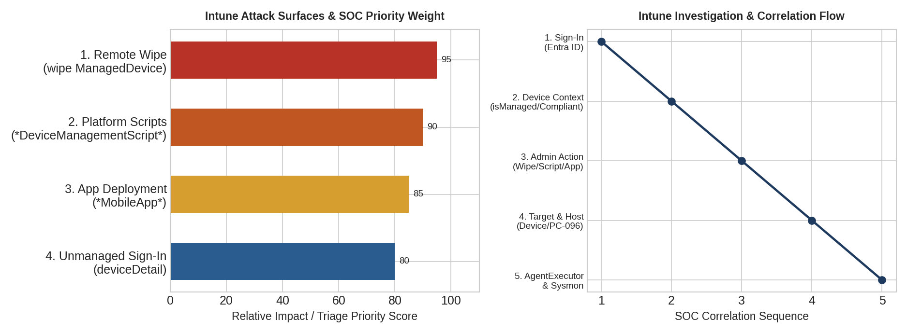

# Microsoft Intune Investigation Findings

## Summary Chart

## Visual Evidence Views (`evidence/screenshots/`)
* `01_intune_unmanaged_signin.png` — Unmanaged device sign-in detection query and deviceDetail fields
* `02_intune_remote_wipe_investigation.png` — Remote wipe investigation (`d66b71f3-a644-4392-89b2-d97ba5612356`, `LPT-03812`, `steven.mills@tryhackme.thm`, `149.40.62.43`)
* `03_intune_platform_scripts_pc096.png` — Platform script investigation (`c0709410-f1e0-4619-ac73-eca347ca1b8b`, `2026-03-17 18:57:57`, `THM{hello_world_from_intune!}`)
* `04_intune_mobile_app_and_hardening.png` — MobileApp discovery and Windows `AgentExecutor.exe` / `AgentExecutor.log` artifacts

## Key Case Answers
* **Wiped Device ID:** `d66b71f3-a644-4392-89b2-d97ba5612356`
* **Wiped Windows Device Hostname:** `LPT-03812`
* **Admin Wipe Source IP:** `149.40.62.43` (`steven.mills@tryhackme.thm`)
* **Deleted Intune Script `resourceId`:** `c0709410-f1e0-4619-ac73-eca347ca1b8b`
* **Script Deployment Timestamp:** `2026-03-17 18:57:57`
* **Deployed Script Output on `PC-096`:** `THM{hello_world_from_intune!}`
