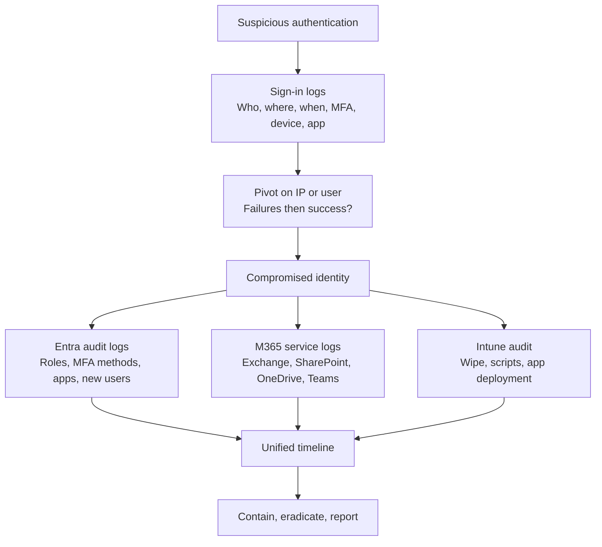
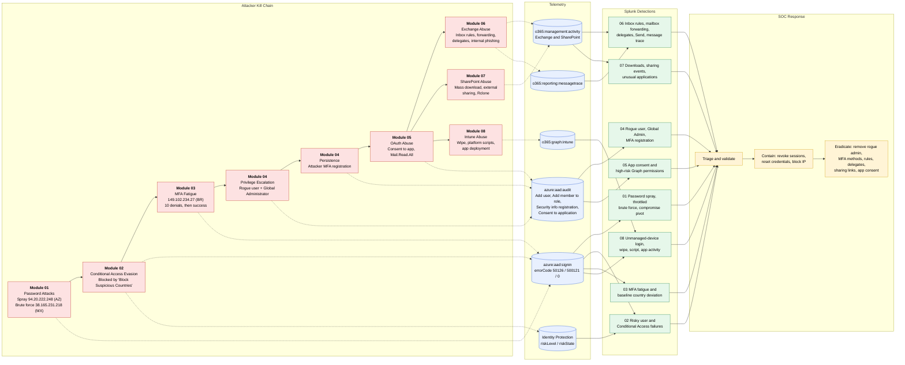
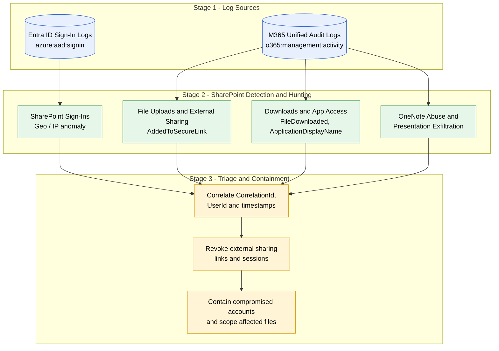

# Operation Cloud Mailwatch — Microsoft Cloud Identity-Threat Monitoring

A security monitoring, threat-hunting, and incident response portfolio project focused on detecting and investigating identity-based attacks against **Microsoft Entra ID** (`finegalo.thm`) and the **Microsoft 365** services behind it (Exchange Online, SharePoint Online) and **Microsoft Intune**, using **Splunk**.

> **Core idea:** in a Microsoft cloud environment the attacker's goal is often not to break into the network but to *become a legitimate identity*. This project follows that identity from the first failed password through to mailbox abuse, data exfiltration, and endpoint-management abuse.

---

## Project Overview

| Attribute | Details |
| :--- | :--- |
| **Project Name** | Operation Cloud Mailwatch |
| **Target Environment** | Microsoft Entra ID (Azure AD), Microsoft 365, Intune — Tenant `finegalo.thm` |
| **SIEM Platform** | Splunk |
| **Project Focus** | Identity-Threat Detection, Threat Hunting & Incident Response |
| **Current Stage** | Phase 2 — Complete SPL Query Pack & Splunk Evidence Integration |

---

## Investigation Model

Every module follows the same three-question model, then joins the answers into a single timeline.

| Log layer | Primary question | Typical sourcetype |
| :--- | :--- | :--- |
| **Entra ID Sign-in Logs** | How did they get in? | `azure:aad:signin` |
| **Entra ID Audit Logs** | What did they change? | `azure:aad:audit` |
| **Identity Protection** | Was the sign-in or user flagged as risky? | `azure:aad:identity_protection:*` |
| **M365 Unified Audit Log** | What did they do (mail, files, sharing)? | `o365:management:activity` |
| **Exchange Message Trace** | Who did the abuse reach? | `o365:reporting:messagetrace` |
| **Intune Audit** | Which devices or apps were managed or wiped? | `o365:graph:intune` |



> **Golden rule:** never treat one authentication event as the whole incident. Build the timeline, pivot on indicators, correlate logs, and determine what happened before and after the suspicious event.

---

## End-to-End Attack Kill Chain & Detection Architecture

The diagram models the full identity intrusion lifecycle: external password attacks and MFA fatigue, account takeover, privilege escalation and persistence, OAuth abuse, and the post-compromise abuse of Exchange, SharePoint, and Intune. Dotted arrows show where each stage leaves evidence; solid arrows show the flow from telemetry to detections to response.



---

## Threat Coverage & Investigation Findings

Validation status is stated honestly: **Validated** means the detection was run in Splunk and a screenshot is stored in `evidence/screenshots/`. **Detection logic documented** means the SPL and investigation reasoning are written up but have not yet been tested against lab data.

| Module | Threat Domain | Key Telemetry & Observed Findings | Validation Status |
| :--- | :--- | :--- | :--- |
| **01** | **Password-Based Attacks** | • **Password Spray:** `94.20.222.248` (`AZ`) targeted **7 unique accounts** with **14 failed attempts** (`status.errorCode=50126`, 2 failures per user).<br>• **Throttling Brute Force & Compromise:** `38.165.231.218` (`MX`) targeted `amanda.costa@finegalo.thm` with **4 failed attempts** followed by **3 successful logins** (`status.errorCode=0`). | **Validated (4 Splunk Screenshots)** |
| **02** | **Conditional Access & Identity Protection** | • **Risky User:** `allan.senna@finegalo.thm` flagged in Identity Protection (`riskLevel=high`, `riskState=atRisk`, event time `2026-03-03 19:46:39`, `anonymizedIPAddress` risk context).<br>• **Conditional Access Enforcement:** Policy **`Block Suspicious Countries`** blocked **6 sign-in attempts** (`conditionalAccessStatus=failure`) to `OfficeHome` (`5` from `94.20.222.251` between `13:30:26`–`13:31:16` and `1` from `94.20.222.248` at `12:51:53`). | **Validated (2 Splunk Screenshots)** |
| **03** | **MFA Bypass Techniques** | • **MFA Fatigue Attack:** `igor.bicalho@finegalo.thm` targeted from `149.102.234.27` (`BR`) with **10 consecutive MFA prompt denials** (`status.errorCode=500121`) between `12:30:06` and `13:24:13`.<br>• **Geographic Baseline & Compromise:** User baseline sign-ins originated from `96.0.24.134` in **Denmark (`DK`)**; attacker achieved a successful login (`status.errorCode=0`) from `149.102.234.27` (**Brazil (`BR`)**) at `2026-03-04 13:26:22`. | **Validated (3 Splunk Screenshots)** |
| **04** | **Privilege Escalation & Persistence** | • **Account Creation (`2026-03-04 13:31:48.764`):** Compromised actor `igor.bicalho@finegalo.thm` executed `Add user` to create `rafael.maciel@finegalo.thm`.<br>• **Role Elevation (`2026-03-04 13:31:49.154`):** `igor.bicalho@finegalo.thm` executed `Add member to role` assigning **`Global Administrator`** (`62e90394-69f5-4237-9190-012177145e10` / `TenantAdmins`) to `rafael.maciel@finegalo.thm`.<br>• **MFA Persistence (`2026-03-04 13:36`):** `User started security info registration` (`operationType="Add"`) recorded. | **Validated (2 Splunk Screenshots)** |
| **05** | **OAuth Application Abuse** | • **Audit Monitoring:** Tracking `activityDisplayName="Consent to application"` in `azure:aad:audit`.<br>• **High-Risk Scope Focus:** Detecting tenant-wide mailbox read exposure via **`Mail.Read.All`**. | Detection logic documented |
| **06** | **Exchange Online Compromise** | • **Initial access:** Outlook Web sign-ins (`appDisplayName="One Outlook Web"`) reviewed for source IP, city, and error code.<br>• **Mailbox activity:** `MailItemsAccessed`, `New-InboxRule`, `Set-InboxRule`, `Set-Mailbox`, `Add-MailboxPermission`, and `Send` in `o365:management:activity`.<br>• **Red flags:** external `ForwardTo`, `DeleteMessage=True`, `DeliverToMailboxAndForward=False`, `SaveToSentItems=False`.<br>• **Scoping:** message trace to identify recipients and delivery status of phishing sent from the compromised mailbox. | Detection logic documented |
| **07** | **SharePoint Online Monitoring** | • **Discovery and collection:** `FileAccessed`, `FileDownloaded`, download volume by user and by hour to expose spikes.<br>• **Sharing and exposure:** `AddedToSecureLink`, `AnonymousLinkCreated`, `SharingSet`, `SecureLinkUsed`, `AnonymousLinkUsed`.<br>• **Tooling:** unusual `ApplicationDisplayName` / `UserAgent` values such as Rclone.<br>• **SharePoint as phishing infrastructure:** trace a malicious `ObjectId` from upload to recipients to openers. | Detection logic documented |
| **08** | **Intune Abuse** | • **Early warning:** Intune portal sign-ins from unmanaged or non-compliant devices (`deviceDetail.isManaged`, `deviceDetail.isCompliant`).<br>• **Destructive and execution actions:** `wipe ManagedDevice`, `*DeviceManagementScript*` create / assign / delete, and `*MobileApp*` deployment in `o365:graph:intune`.<br>• **Endpoint correlation:** `IntuneWindowsAgent.exe` → `AgentExecutor.exe` → `powershell.exe`, and `AgentExecutor.log`. | Detection logic documented |

---

## Module Highlights

### 01 — Password-Based Attacks
Password spraying (one source, many users, few attempts each) is separated from brute force (one user, many attempts). Failures are aggregated by source IP, then the **successful-login pivot** asks whether the same IP authenticated to any account.

```text
Event → Indicator → Pivot → Related events → Attack story
```

### 02 — Conditional Access & Identity Protection
Conditional Access is an IF/THEN engine, so `appliedConditionalAccessPolicies` shows which control acted. Identity Protection data (`riskdetection`, `risky_user`) is correlated with sign-ins, because risk flags are signals rather than verdicts.

### 03 — MFA Bypass Techniques
Covers MFA fatigue (error `500121`), number matching, SIM swapping, AiTM, and impossible travel. Location deviation from the user's baseline is treated as a pivot, not a conclusion, because of VPN and travel false positives.

### 04 — Privilege Escalation & Persistence
Audit logs are read with three fields: `activityDisplayName` (what), `initiatedBy` (who), and `targetResources` (to whom). The observed chain is account creation, then role assignment, then attacker-controlled MFA registration.

### 05 — OAuth Application Abuse
Application consent survives password resets, so persistence through OAuth is hunted via consent events and high-risk scopes (`Mail.Read.All`, `Mail.ReadWrite.All`, `Files.ReadWrite.All`, `Directory.ReadWrite.All`, `RoleManagement.ReadWrite.Directory`, `offline_access`).

### 06 — Exchange Online Compromise
```text
Get in → Look around → Stay hidden → Steal mail → Abuse trust → Spread
```
Inbox rules provide concealment, mailbox forwarding provides collection, delegate permissions provide persistence that a password reset does not remove, and message trace scopes the phishing campaign.

### 07 — SharePoint Online Monitoring
```text
Authenticate → Discover → Collect → Share → External link used → Automate → Exfiltrate
```
Baselines beat fixed thresholds: 1,400 downloads is suspicious for a user who normally downloads ten files a day, and ordinary for a backup account.

### 08 — Intune Abuse
```text
Compromised admin → Intune login → Wipe | Script | App deployment
```
The login is the early warning and the wipe is late detection. Detections target the unmanaged-device sign-in and script create/assign activity *before* destructive action.

---

## Detection Pipeline (SharePoint Example)



---

## Sample Detection Queries

Index names (`scenario`, `m365`, `intune`, `task-N`) come from the lab datasets and should be adjusted for your own Splunk environment. The full query pack lives in [`detections/splunk/`](detections/splunk/).

**Failed sign-ins summarised per user (Module 01)**
```spl
index="scenario" sourcetype="azure:aad:signin" "status.errorCode"!=0
| stats count as event_count values(ipAddress) as ip_addresses
        values(appDisplayName) as applications
        values(status.errorCode) as errorCodes
        by userPrincipalName
| sort - event_count
```

**Did a suspicious IP ever succeed? (Module 01 pivot)**
```spl
index="scenario" sourcetype="azure:aad:signin" "status.errorCode"=0 ipAddress="<ADD-IP-HERE>"
```

**Changes performed by a compromised user (Module 04)**
```spl
index="scenario" sourcetype="azure:aad:audit" initiatedBy.user.userPrincipalName="<ADD-USER-EMAIL>"
| sort - _time
| table _time, initiatedBy.user.userPrincipalName, activityDisplayName, result, targetResources{}.userPrincipalName
```

**Mailbox-level forwarding (Module 06)**
```spl
index=* Workload=Exchange Operation=Set-Mailbox
| table _time UserId ForwardingSmtpAddress DeliverToMailboxAndForward
```

**Download spikes per user per hour (Module 07)**
```spl
index=m365 Workload=SharePoint Operation=FileDownloaded
| bin _time span=1h
| stats count as downloads by _time UserId
| sort - downloads
```

**Intune sign-in from a device with no name (Module 08)**
```spl
index=intune sourcetype=azure:aad:signin appDisplayName=*Intune* deviceDetail.displayName=""
| rename deviceDetail.* as dvc.*
| table _time appDisplayName ipAddress dvc.isManaged dvc.isCompliant dvc.displayName user
```

---

## MITRE ATT&CK Mapping (Indicative)

| Module | Technique | ATT&CK ID |
| :--- | :--- | :--- |
| 01 | Password Spraying / Brute Force | T1110.003 / T1110.001 |
| 01, 03 | Valid Accounts: Cloud Accounts | T1078.004 |
| 03 | Multi-Factor Authentication Request Generation | T1621 |
| 04 | Create Account: Cloud Account | T1136.003 |
| 04 | Account Manipulation: Additional Cloud Roles | T1098.003 |
| 04 | Modify Authentication Process: Multi-Factor Authentication | T1556.006 |
| 05 | Steal Application Access Token | T1528 |
| 06 | Email Collection: Email Forwarding Rule | T1114.003 |
| 06 | Hide Artifacts: Email Hiding Rules | T1564.008 |
| 06 | Account Manipulation: Additional Email Delegate Permissions | T1098.002 |
| 06 | Internal Spearphishing | T1534 |
| 07 | Data from Information Repositories: SharePoint | T1213.002 |
| 07 | Exfiltration Over Web Service | T1567 |
| 08 | Software Deployment Tools | T1072 |
| 08 | Data Destruction | T1485 |

> These mappings are provided for orientation and should be reviewed against the current ATT&CK matrix before being cited formally.

---

## Repository Structure

```text
operation-cloud-mailwatch-entra-id-monitoring/
│
├── README.md                                              # Project landing page, kill-chain diagram & findings summary
├── BUILD-STATUS.md                                        # Phased build tracker and validation matrix
│
├── docs/
│   ├── 01-entra-id-monitoring-source.md                   # Preserved source investigation notes (unmodified)
│   ├── m365-foundations.md                                # Identity, SSO, Entra ID, and Microsoft 365 background notes
│   └── architecture-and-workflows.md                      # Mermaid diagrams: kill chain, detection pipeline & SOC workflows
│
├── detections/
│   └── splunk/
│       ├── README.md                                      # SPL detection index & validation policy
│       ├── all-detections.spl                             # Consolidated, runnable SPL query pack
│       ├── 01-password-based-attacks.md
│       ├── 02-conditional-access-identity-protection.md
│       ├── 03-mfa-bypass-techniques.md
│       ├── 04-privilege-escalation-persistence.md
│       ├── 05-oauth-application-abuse.md
│       ├── 06-exchange-online-compromise.md               # Inbox rules, forwarding, delegates, Send, message trace
│       ├── 07-sharepoint-online-monitoring.md             # Downloads, external sharing, Rclone, malicious-file tracing
│       └── 08-intune-abuse.md                             # Unmanaged-device login, wipe, scripts, app deployment
│
├── investigation-playbooks/
│   └── README.md                                          # Step-by-step SOC analyst triage & containment playbooks
│
├── evidence/
│   └── screenshots/
│       ├── README.md                                      # Screenshot inventory and query mapping
│       ├── 01-password-attacks-failed-signins-timeline.png
│       ├── 01-password-spray-ip-aggregation.png
│       ├── 01-throttling-bruteforce-per-user-ip.png
│       ├── 01-throttling-bruteforce-compromise-pivot.png
│       ├── 02-risky-user-identity-protection.png
│       ├── 02-conditional-access-block-suspicious-countries.png
│       ├── 03-mfa-fatigue-500121-summary.png
│       ├── 03-mfa-baseline-country-signins.png
│       ├── 03-mfa-fatigue-dk-to-br-timeline.png
│       ├── 04-rogue-user-creation-audit.png
│       └── 04-privileged-role-assignment-audit.png
│
└── references/
    └── README.md                                          # Entra ID schemas, error codes, CIM & MITRE ATT&CK mapping
```

---

## Build Status

| Phase | Scope | Status |
| :--- | :--- | :--- |
| Phase 1 | Repository scaffold, source notes, kill-chain diagram | Complete |
| Phase 2 | Complete SPL query pack and Splunk evidence integration | In progress |
| Phase 3 | Lab validation and screenshots for Modules 05–08 | Planned |
| Phase 4 | Investigation playbooks and MITRE ATT&CK refinement | Planned |

---

## Investigation Playbook Summary

1. **Validate the sign-in:** who, source IP, location, device, MFA result, Conditional Access outcome.
2. **Pivot:** did the same IP succeed against other accounts, and did the user's baseline location change?
3. **Check Entra audit logs:** new users, role assignments, MFA registration, consent grants (initiator versus target).
4. **Check M365 activity:** mailbox access, rules, forwarding, delegates, file downloads, sharing, unusual applications.
5. **Check Intune:** unmanaged-device admin sign-ins, scripts, app deployments, wipes, then endpoint telemetry.
6. **Build the timeline:** authentication, access, persistence, collection, exfiltration or impact.
7. **Contain:** revoke sessions and tokens, reset credentials, block IPs.
8. **Eradicate:** remove rogue accounts, roles, MFA methods, inbox rules, forwarding, delegates, sharing links, and app consent.

---

## Responsible Use & Validation Policy

- Findings in this repository come from an intentionally vulnerable **training lab** tenant (`finegalo.thm`). No production data is included.
- A detection is only labelled **Validated** when it has been executed in Splunk and has matching evidence in `evidence/screenshots/`.
- Detections labelled **Detection logic documented** are starting points and may need tuning, baselines, and allow-lists before use in a real environment.
- Behaviours such as new inbox rules, Rclone usage, anonymous links, or unmanaged-device sign-ins are *risk indicators, not proof of compromise*. Always confirm against baseline and context.

---

## Skills Demonstrated

Splunk SPL (`stats`, `bin`, `eval`, `spath`, `mvexpand`), Entra ID sign-in and audit analysis, Conditional Access and Identity Protection review, MFA attack detection, OAuth abuse hunting, Exchange and SharePoint audit investigation, Intune abuse detection, timeline-based incident reconstruction, and MITRE ATT&CK mapping.
